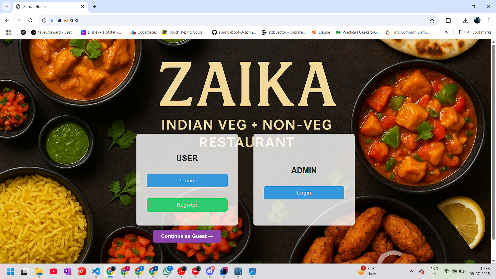
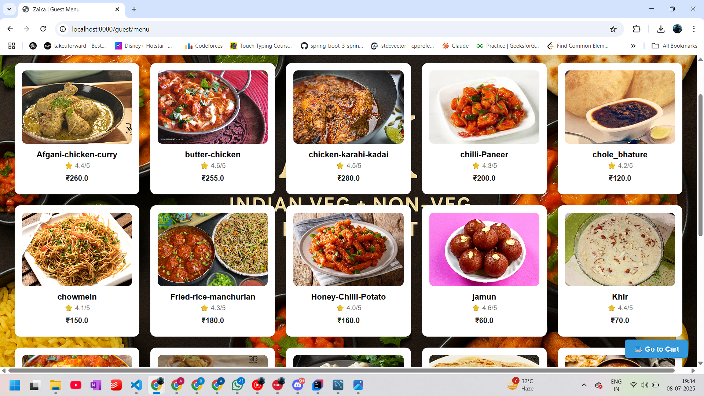
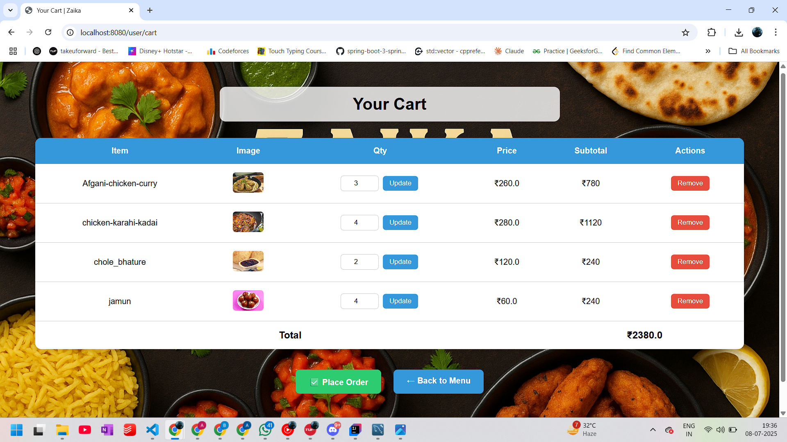
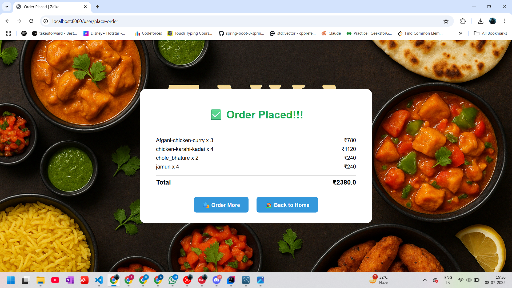

# Zaika 🍽️
Zaika is a full-stack restaurant menu and ordering system with user roles (Admin, User, Guest). It supports interactive cart-based ordering, price editing for admins, and secure login via Spring Security. Built with **Spring Boot**, **Thymeleaf**, and **MySQL**, it delivers a clean, modern UI with real-time menu item updates and user-specific navigation.



---

## Features

- **Dynamic Menu System**
    - **Admin Menu**: View, edit, and update prices with live buttons.
    - **User Menu**: Add items to cart using `+/-` buttons and checkout.
    - **Guest Menu**: Explore items, but redirected on checkout.

- **User Roles & Authentication**
    - Spring Security with custom `UserDetailsService`
    - Login and registration system
    - Role-based redirection (Admin → dashboard, User → menu)

- **Cart Functionality**
    - Quantity management per item
    - Subtotal/total updates in real-time
    - Cart persistence across views (menu, cart)

- **Order Placement**
    - Orders and item/price snapshots are saved to MySQL; on successful order,
      quantities reset and confirmation is shown.

- **Modular Architecture**
    - Clean controller-service-entity-repository structure
    - Uses Thymeleaf fragments (`navbar`, etc.)

- **Assets**
    - Organized image directory
    - Global CSS for consistent styling

---

## Technology Stack

- **Backend**: Spring Boot, Spring MVC, Spring Security, Spring Data JPA
- **Frontend**: Thymeleaf, HTML, CSS, JavaScript
- **Database**: MySQL
- **Security**: BCrypt password hashing, role-based access
- **IDE**: IntelliJ IDEA

---

## Setup and Installation

### 1. Clone the Repository

```bash
git clone https://github.com/aayien-IITI/zaika.git
cd zaika
```

### 2. Configure the FreeDB MySQL connection

The application connects to `freedb_U2g2wSdT` on `sql.freedb.tech:3306`.
Set the FreeDB-issued credentials in the environment before starting the
application. Do not put credentials in `application.properties` or commit them.

PowerShell:

```powershell
$env:DB_USERNAME = "your_freedb_username"
$env:DB_PASSWORD = "your_freedb_password"
```

Command Prompt:

```bat
set DB_USERNAME=your_freedb_username
set DB_PASSWORD=your_freedb_password
```

The datasource uses the existing MySQL Connector/J driver. Hibernate uses the
MySQL dialect and `spring.jpa.hibernate.ddl-auto=update` to create or update
tables for the existing JPA entities when the application connects. The FreeDB
account must have permission to connect from your network and create/alter
tables in the database. The database server must be reachable on TCP port 3306.

### 3. Run the Application

```bash
./mvnw spring-boot:run
```

On Windows, use `.\mvnw.cmd spring-boot:run`. Build and run the test suite with
`./mvnw clean package` (or `.\mvnw.cmd clean package` on Windows); both commands
require `DB_USERNAME` and `DB_PASSWORD` to be set for a database-backed test
context.

### 4. Access the App

Visit: `http://localhost:8080`

---

## Screenshots


- 
- 
- 
- 
- 

---

## Project Structure

```bash
src/
├── main/
│   ├── java/com.adityaPandit.zaika/
│   │   ├── config/                  # Security and exception handlers
│   │   ├── controllers/            # All MVC controllers
│   │   ├── entities/               # JPA entity classes
│   │   ├── repositories/           # Spring Data repositories
│   │   ├── security/               # Custom security configuration
│   │   └── services/               # Business logic
│   ├── resources/
│   │   ├── static/
│   │   │   ├── css/
│   │   │   └── images/
│   │   └── templates/              # Thymeleaf HTML templates
│   └── application.properties
└── test/
```

---

## License

MIT License
